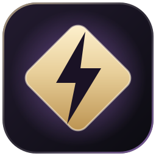

<h1>BDO Graphics Switcher</h1>

<b>One click. Every frame you can get.</b> 
NVIDIA driver profiles · weekly checklist · Italian translation — for Black Desert Online, crafted by <b>Judgmentz</b>

  

One small <code>.exe</code> &nbsp;·&nbsp; nothing to install &nbsp;·&nbsp; <a href="https://github.com/Judgmentz/BDO-Graphics-Switcher/releases">all releases</a>

  

&nbsp;&nbsp;

<b>Graphics</b> &nbsp;·&nbsp; <b>Weekly</b> &nbsp;·&nbsp; <b>Italian</b>

 

> [!TIP]
> ### 🆕 What's new in v1.4.1
> - 🇮🇹 **Italian replaces English by default** — just keep the game language on *English*
> - ⭐ **One source, always fresh:** the Judgmentz Edition updates itself every time you open the app
> - 🔀 **Switch the replaced language anytime** — even with Italian already installed
> - 🔐 **Signed build** — verified before it installs
>
> Coming from v1.3.0 or newer? The app will offer the update by itself.

 

## ✨ Why you'll love it

<table>
<tr>
<td width="50%" valign="top">

### ⚡ One click, max FPS
Switch the whole NVIDIA profile for Black Desert in a second — no digging through control panels.

</td>
<td width="50%" valign="top">

### 🧠 Knows where you are
Reads the driver on launch and highlights the preset that's already active.

</td>
</tr>
<tr>
<td width="50%" valign="top">

### 🛡️ Clean & self-contained
Talks straight to the NVIDIA driver (NvAPI). No bundled tools, no temp files, never touches your game files.

</td>
<td width="50%" valign="top">

### 🎬 Feels premium
Animated dark UI, live preset meters and in-game tips after every switch.

</td>
</tr>
<tr>
<td width="50%" valign="top">

### 📅 Weekly checklist
Every weekly in one place — tick them off and watch each reset count down live.

</td>
<td width="50%" valign="top">

### 🔄 Resets itself
Clears automatically on the weekly reset, even if the app was closed. Works on any GPU.

</td>
</tr>
<tr>
<td width="50%" valign="top">

### 🚀 Updates itself
Checks GitHub on launch and asks before updating — one click and it restarts on the new version.

</td>
<td width="50%" valign="top">

### ✨ Cinematic
Animated intro and outro, smooth tab transitions, and a window that resizes to fit every page.

</td>
</tr>
<tr>
<td width="50%" valign="top">

### 🇮🇹 Plays in Italian
One click installs the Italian translation — and it re-applies itself after every game patch.

</td>
<td width="50%" valign="top">

### 🔐 Can't be faked
Updates and translation files are signed. Anything unsigned or modified is refused.

</td>
</tr>
</table>

## 🎮 Presets

| | Preset | Built for | What changes |
|:-:|---|---|---|
| 🟣 | **Ultra Potato** | Node Wars · Sieges · crowded hubs | V-Sync off · 1 pre-rendered frame · AA & anisotropic off · *High performance* texture filtering · aggressive LOD bias · GPU locked to *Prefer maximum performance* |
| 🟢 | **Normal** | Everything else | Back to NVIDIA driver defaults — full quality |

> [!TIP]
> **Node Wars & Sieges** — pair Ultra Potato with BDO's *Lowest / Optimal* graphics and turn **other players' skill effects off**. Massive fights stay smooth.

> [!WARNING]
> **Arena of Solare** — keep your **opponents' effects ON**. You need to read every skill they throw at you.

## 📅 Weekly Checklist

The **Weekly** tab keeps track of everything that resets each week (EU), grouped and colour-coded:

| Section | Tasks |
|---|---|
| 🟡 **World Bosses** | Garmoth (×3) · Morning Light bosses (×4) · Guild boss |
| 🟣 **Edania** | Purify Edania (×5) · Edania boss |
| 🩵 **Atoraxxion** | Atoraxxion run |
| 🔴 **Dungeons & Shrines** | Pit of the Undying · Black Shrine (×5) · Altar of Blood |
| 🟢 **Training** | Horse Taming · Fly Like the Wind |

- **Click** a task to tick it (or add +1), **right-click** to undo
- Every task shows a live reset badge — <code>THU</code> for the Thursday 00:00 UTC reset, <code>SUN</code> for the Sunday ones
- **Edit list** to hide what you don't do and add your own tasks (any count, Thursday or Sunday reset)
- A badge on the tab shows how many tasks are left

> [!NOTE]
> Weekly content changes with patches — if something's off, adjust it with **Edit list**.

## 🇮🇹 Play in Italian

The **Italian** tab installs the **Judgmentz Edition** of the Italian translation in one click — and keeps it working after every game patch.

1. Close Black Desert and open the **Italian** tab
2. Click **Install Italian**
3. Launch the game with the language on **English** — that's it

- **Replaces English by default** (or German, if you prefer to keep English untouched) — switch anytime
- **Always complete:** lines added by newer game patches are filled in from your own game files, so nothing goes missing
- **Hands-off:** checks for a newer edition every launch and re-applies itself after game patches
- **Safe:** automatic backup · one-click **Restore original** · every edition file is signature-checked
- **Your own touch:** a **Glossary** (e.g. keep gamer terms like *Black Spirit* in English) and a **Line editor** — applied on top, on your PC

> [!NOTE]
> Base translation by **lele344**. Fan-made and unofficial, not affiliated with Pearl Abyss. Use at your own risk.

## 🔐 Signed updates

Every app update and every Judgmentz Edition file is **signed with the developer's private key**, which never leaves the developer's PC.
The app checks the signature before installing anything — an unsigned or modified file is refused, even if it came from GitHub.

## 🚀 Quick start

1. **[Download `BDO_Switcher.exe`](https://github.com/Judgmentz/BDO-Graphics-Switcher/releases/latest/download/BDO_Switcher.exe)**
2. Run it and accept the administrator prompt *(needed to save NVIDIA profiles)*
3. Pick **Ultra Potato** or **Normal** — then (re)start Black Desert

> [!NOTE]
> The exe isn't code-signed, so Windows SmartScreen may warn you the first time: click **More info → Run anyway**.

## 📋 Requirements

| | |
|---|---|
| **OS** | Windows 10 / 11 (64-bit) — .NET Framework 4.8 is built in |
| **GPU** | NVIDIA GeForce with an up-to-date driver |
| **AMD / Intel** | Graphics presets show *not supported* — Weekly and Italian still work |

<b>🔧 How it works</b>

 

The app loads `nvapi64.dll` (shipped with every NVIDIA driver) and uses the driver settings API to edit the **Black Desert** application profile — the same profile you'd see in NVIDIA Profile Inspector.

- Only affects `blackdesert64.exe`, `blackdesert32.exe` and `blackdesert_launcher.exe`
- Before applying, every setting any preset touches is reset, so presets never mix
- **Normal** restores the driver's own defaults for those settings
- Changes apply the next time the game starts

 

**Crafted with ♥ by Judgmentz**

Not affiliated with Pearl Abyss or NVIDIA. Black Desert Online is a trademark of Pearl Abyss.

